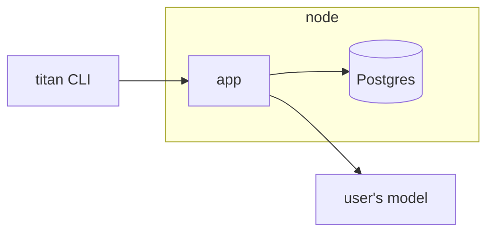
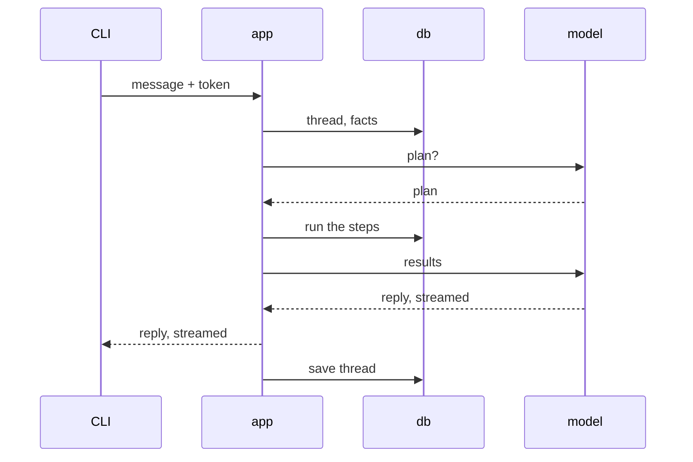

# Architecture

How TITAN is built and why. Read it before changing how the parts fit
together. It describes the prototype; most of it is not built yet.

Draft: the owner has not approved it yet.

## Bird's eye view



The CLI talks only to the app. The app is one process: it signs users in,
keeps their settings, runs the chat and is the only thing that touches the
database. In a chat, the app calls the user's own model; the model can
call tools that read and change the user's tasks and facts.

## Code map

- `backend/`: the app.
  - the API: sign-in, settings, chat;
  - the agent: the planner, the plan runner and the tools, tasks and
    memory;
  - the database: tables and migrations;
  - the admin command that adds users.
- `cli/`: the `titan` command: `login`, `whoami`, `settings`, `chat`.
- `compose.yaml`: the node, the app and Postgres.

## A chat message



A message that needs no action, such as a general question, gets its
reply from the first call, with no plan.

## The agent

The model does not call tools one by one. It answers with a plan, a short
list of steps, and the app runs the plan itself. The idea comes from
LLMCompiler ([arXiv 2312.04511](https://arxiv.org/abs/2312.04511)); the
code is our own.

```json
{"steps": [
  {"id": "s1", "do": "tasks_list", "args": {"status": "overdue"}},
  {"id": "s2", "for_each": "$s1.items", "do": "tasks_update",
    "args": {"id": "$item.id", "due": "2026-10-22"}},
  {"id": "s3", "think": "Which task is the most important?",
    "input": "$s1.items", "output": {"type": "integer"}}
]}
```

- A step is `do` (call a tool), `for_each` (call a tool for each item of
  a list) or `think` (a short model call for a choice code cannot make,
  with a typed answer).
- `$s1.items` is a field of the result of step `s1`. A step refers only to
  steps above it, so the steps run in their order, one at a time.
- The model sends the plan as a call of the one tool `run_plan`.
- Before the first step runs, the app checks the plan: every tool exists,
  the arguments fit its schema, every reference points up, and the plan
  is not too long. A plan that fails goes back to the model with the
  error.
- Every step runs for the user of the message only.
- All the changes of one message run in one database transaction and
  commit before the reply. When a step fails, the whole plan rolls back;
  the model gets the error and makes a new plan, once or twice. After
  that, the app falls back to a plain loop, one tool call at a time, in
  the same transaction.
- The last model call gets the results and writes the reply.
- The model is called over `httpx` with the OpenAI chat completions API.
  The read timeout is the longest silence between two chunks, never a
  limit on the whole reply.

## Invariants

- Every request carries a token; nothing is open, on any network.
- Every row of user data has a `user_id`; every query filters by it, and
  row-level security in Postgres is the second guard.
- Only the data module runs SQL. Each of its functions takes the
  `user_id`, takes and returns plain data, never ORM objects or sessions,
  and runs in the transaction of its caller.
- A model key is encrypted with the node's key before it is stored. The
  node's key is a file, not in the database, so a database dump alone
  does not reveal model keys.
- The app never calls the node's own private addresses for a user's
  model URL.
- Logs hold no message text, keys or tokens.

## Decisions

- **One process, not services.** A node serves one person or a family; one
  process is enough and keeps the code small.
- **No separate data server yet.** The data module is the boundary in the
  code; it becomes a service of its own only when domains run code we do
  not trust.
- **One transaction per message.** A plan applies fully or not at all, and
  Postgres lets each step read the changes before it. The transaction
  stays open while the model answers; that is fine for a node of one
  person or a family. Holding the changes in the app until the commit
  comes later, with many users or a data server.
- **SQLAlchemy inside the data module.** Async, with the `psycopg` 3
  driver, which also serves the sync scripts; migrations with Alembic.
  SQLAlchemy objects and sessions never leave the module.
- **Sign-in by a one-time code, for now.** The admin adds a user and
  hands them a code; the CLI trades it for a token. Codes and tokens are
  long and random, so the node keeps only their SHA-256.
- **Postgres for everything.** Users, threads, tasks and facts live in one
  database, backed up with one `pg_dump`.
- **The user brings the model.** TITAN ships no model; any
  OpenAI-compatible endpoint works, local or in the cloud.
- **Our own plan runner, not LangGraph.** It needs about 150 lines on
  `httpx`, which the app has anyway. LangGraph would bring about 46
  packages, keep threads in its own tables without a `user_id`, and its
  checkpoint loading has had several deserialization flaws.
- **Plans, not one tool call at a time.** A plan takes two model calls
  instead of one per step, and the app checks all of it before anything
  changes.
- **Threads in our own table of messages.** Each row has a `user_id`, like
  every other table.
- **Go for the CLI.** One static binary for every platform.
- **Library defaults first.** A setting is added only when a default
  breaks something.

## Open questions

Proposals the owner has not decided yet:

- The data model: User, Token, Provider, Thread, Message, Task, Fact.
- Reminders: shown on the next run of `titan` first, a background
  `titan watch` later.
- Memory: the model saves a fact with an explicit tool call; every fact
  goes into the prompt until there are about 200 of them.
- Deleting: no "are you sure?", but a soft delete that can be undone.
- A model for the whole node: none for now, each user brings their own.
